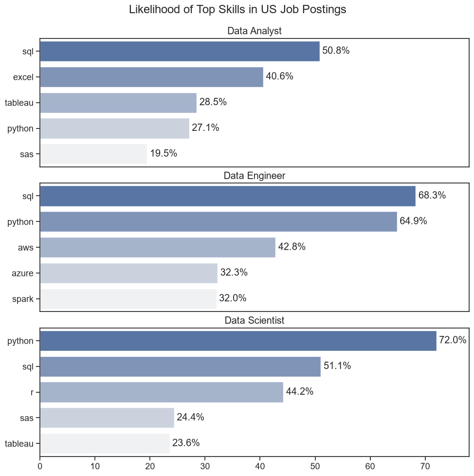
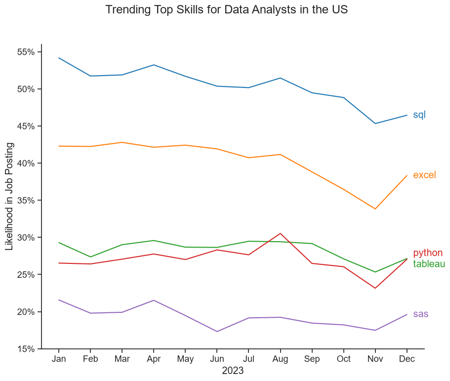
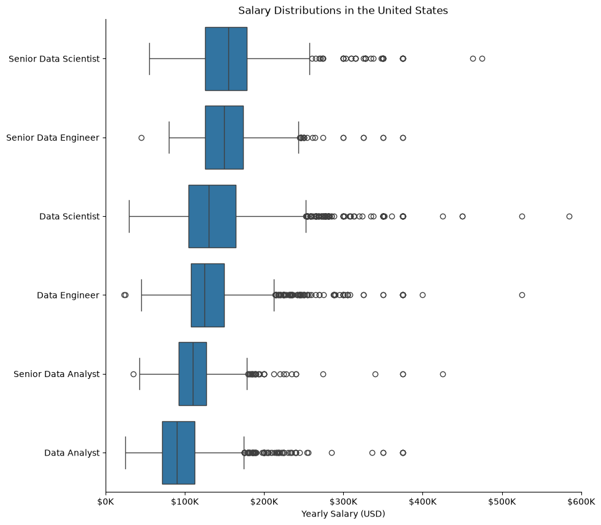
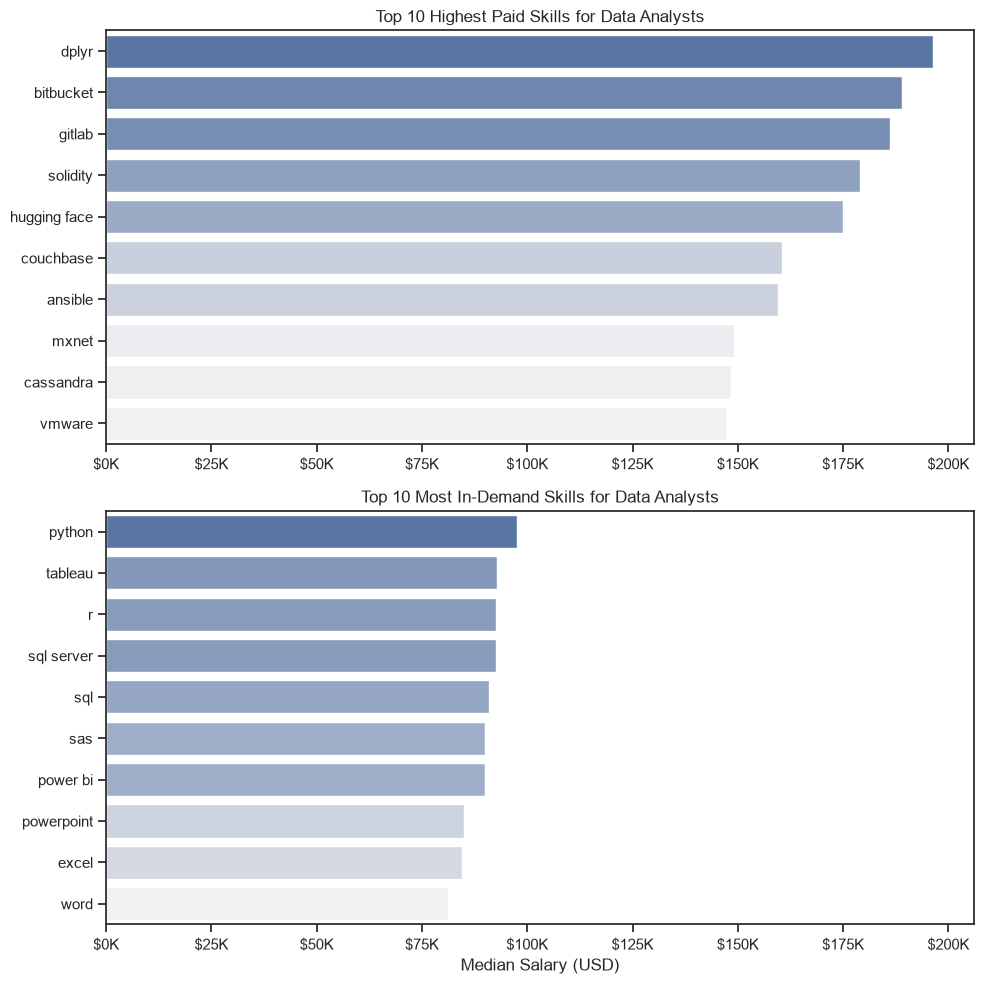
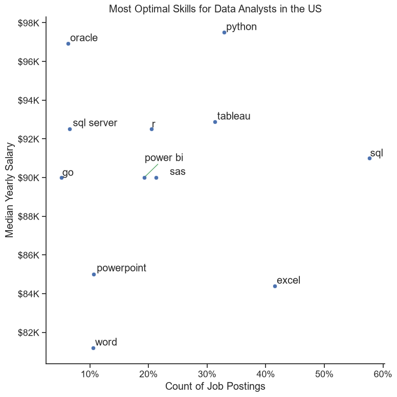
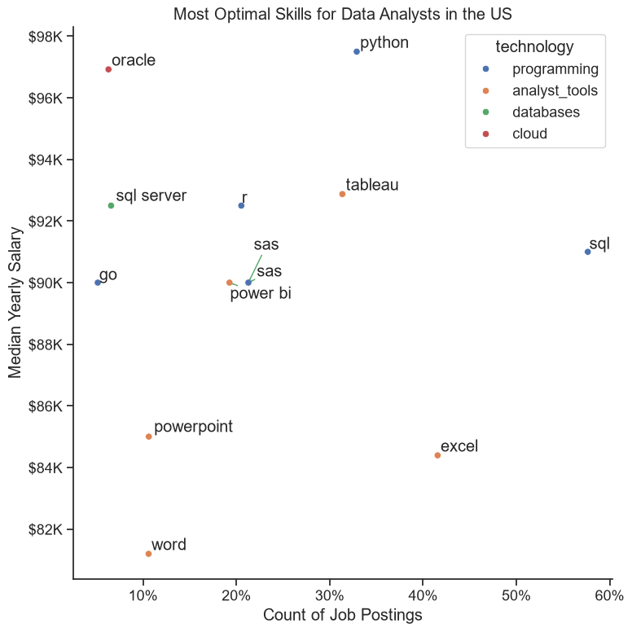

# U.S. Data Analyst Job Market Analysis

## Overview

This project explores the U.S. data job market with a focus on Data Analyst roles. I used Python to examine where opportunities are concentrated, which skills employers request, how demand changes over time, and how skills relate to reported salaries.

The analysis uses the `lukebarousse/data_jobs` dataset from the [Python for Data Analytics course](https://lukebarousse.com/python). The dataset contains 785,741 job postings dated from January 1 through December 31, 2023. Each row represents a job posting before the skills column is expanded.

## Questions

1. Where are U.S. Data Analyst opportunities concentrated, and what characteristics appear in the postings?
2. Which skills are most requested for the three leading data roles?
3. How does demand for Data Analyst skills change during the year?
4. How do salaries differ across data roles and Data Analyst skills?
5. Which skills combine relatively high demand with relatively high median pay?

## Key Findings

- **SQL is the core cross-role skill.** It appears in 50.8% of Data Analyst, 68.3% of Data Engineer, and 51.1% of Data Scientist postings.
- **Python is especially important for technical roles.** It appears in 72.0% of Data Scientist and 64.9% of Data Engineer postings, compared with 27.1% for Data Analysts.
- **Data Analyst skill demand softened late in 2023.** SQL declined from 54.2% of postings in January to 46.4% in December. Excel fell from 42.3% to 38.3%, while Python finished close to where it started.
- **Role seniority and specialization align with higher median salaries.** Among the six most frequently represented U.S. roles with reported annual salaries, the medians range from $90,000 for Data Analysts to $155,000 for Senior Data Scientists.
- **Python offers the strongest balance of demand and pay in the salary-reported Data Analyst sample.** It appears in 32.9% of those postings and has a median salary of $97,500.
- **The highest skill medians require caution.** Several top-paying skills have only one to three salary observations, so they are less reliable than findings based on common skills.

## Dataset and Scope

| Item | Scope used in this project |
|---|---|
| Source | `lukebarousse/data_jobs` |
| Date range | January 1-December 31, 2023 |
| Full dataset | 785,741 job postings |
| Primary market | United States |
| Primary role | Data Analyst |
| U.S. Data Analyst sample | 67,816 postings |
| Salary-reported U.S. Data Analyst sample | 4,350 postings |
| Main salary metric | Median `salary_year_avg` |
| Skill-demand metric | Share of postings mentioning a skill |

The salary analyses exclude postings without `salary_year_avg`. Consequently, skill percentages in the salary notebooks describe the 4,350 salary-reported postings rather than all 67,816 U.S. Data Analyst postings.

## Tools

- **Python** for the analysis
- **pandas** for filtering, reshaping, grouping, joining, and aggregation
- **Matplotlib** and **Seaborn** for visualization
- **adjustText** for readable scatter-plot labels
- **Jupyter Notebook** for reproducible analysis and documentation
- **Visual Studio Code** for development
- **Git and GitHub** for version control and project sharing

## Data Preparation

The notebooks follow a consistent preparation process:

1. Load the Hugging Face dataset into a pandas DataFrame.
2. Convert `job_posted_date` to a datetime value.
3. Parse `job_skills` from string representations into Python lists.
4. Filter by country and standardized job title.
5. Explode the skills list when the analysis requires one row per posting-skill combination.
6. Remove missing annual salaries only for salary-dependent calculations.

## Analysis

### 1. Exploratory analysis of U.S. Data Analyst postings

[View the exploratory analysis notebook](1_EDA_Intro.ipynb)

The first notebook establishes the project scope and examines locations, posting characteristics, and companies for 67,816 U.S. Data Analyst postings.

Selected findings:

- "Anywhere" is the most common location label with 5,106 postings, followed by New York City with 3,035 and Atlanta with 2,741.
- 7.5% of postings are marked as offering work from home.
- 28.0% do not mention a degree requirement.
- 35.5% mention health insurance.
- Robert Half has the most postings in the filtered sample (959), followed by Insight Global (827) and Dice (584).

Recruiting and staffing companies appear prominently, so company counts should not be interpreted as a direct ranking of end employers.

### 2. Skills requested for the three leading data roles

[View the skill-demand notebook](2_Skills_Count.ipynb)

I expanded the skills field, counted skill mentions by standardized role, and divided each count by the total postings for that role.



Top five skills by role:

| Data Analyst | Share | Data Engineer | Share | Data Scientist | Share |
|---|---:|---|---:|---|---:|
| SQL | 50.8% | SQL | 68.3% | Python | 72.0% |
| Excel | 40.6% | Python | 64.9% | SQL | 51.1% |
| Tableau | 28.5% | AWS | 42.8% | R | 44.2% |
| Python | 27.1% | Azure | 32.3% | SAS | 24.4% |
| SAS | 19.5% | Spark | 32.0% | Tableau | 23.6% |

SQL and Python transfer well across roles, while the surrounding skill mix differs. Data Engineering emphasizes cloud and distributed-processing tools; Data Analysis emphasizes spreadsheets and visualization; Data Science places more weight on programming and statistical tools.

### 3. Monthly Data Analyst skill trends

[View the monthly-trends notebook](3_Skills_Trend.ipynb)

For each month, I divided skill mentions by the total number of U.S. Data Analyst postings in that month. This controls for changes in overall posting volume.



Selected findings:

- SQL remains the most requested skill throughout 2023 but declines from 54.2% in January to 46.4% in December.
- Excel starts at 42.3%, reaches a low of 33.8% in November, and recovers to 38.3% in December.
- Python is comparatively stable: 26.5% in January, a peak of 30.5% in August, and 27.0% in December.
- Tableau stays near the upper-20% range for most of the year.
- SAS remains fifth among these skills and ends at 19.6%.

These are descriptive monthly patterns. They do not establish why demand changed or whether the changes will continue beyond 2023.

### 4. Salary distributions across data roles

[View the salary-analysis notebook](4_Salary_Analysis.ipynb)

The salary comparison uses U.S. postings with a reported average annual salary. The six roles are selected by their frequency within that salary-reported sample and ordered by median pay.



| Role | Salary observations | Median annual salary |
|---|---:|---:|
| Senior Data Scientist | 1,241 | $155,000 |
| Senior Data Engineer | 1,058 | $150,000 |
| Data Scientist | 4,553 | $130,000 |
| Data Engineer | 2,915 | $125,000 |
| Senior Data Analyst | 913 | $110,000 |
| Data Analyst | 4,350 | $90,000 |

The distributions overlap and contain high-value outliers, so the median is more representative of typical pay than the maximum.

### 5. Highest-paid and most frequently requested Data Analyst skills

The skill-level salary analysis groups salary-reported U.S. Data Analyst postings by skill and calculates both observation counts and median salaries.



Among frequently listed skills, the strongest median salaries are:

| Skill | Salary observations | Median annual salary |
|---|---:|---:|
| Python | 1,431 | $97,500 |
| Tableau | 1,364 | $92,875 |
| R | 893 | $92,500 |
| SQL Server | 286 | $92,500 |
| SQL | 2,508 | $91,000 |

The nominal highest-paying list includes dplyr ($196,250), Bitbucket ($189,000), and GitLab ($186,000), but these values are based on only two or three observations each. They should be treated as sparse-sample signals, not stable market benchmarks.

### 6. Skills that balance demand and pay

[View the optimal-skills notebook](5_Optimal_Skills.ipynb)

This notebook compares median salary with the percentage of salary-reported U.S. Data Analyst postings that mention each skill. Skills must appear in more than 5% of the filtered postings to enter the comparison.



| Skill | Share of salary-reported postings | Median annual salary |
|---|---:|---:|
| SQL | 57.7% | $91,000 |
| Excel | 41.6% | $84,392 |
| Python | 32.9% | $97,500 |
| Tableau | 31.4% | $92,875 |
| SAS | 21.3% | $90,000 |
| R | 20.5% | $92,500 |
| Power BI | 19.3% | $90,000 |
| SQL Server | 6.6% | $92,500 |
| Oracle | 6.3% | $96,924 |

Python stands out for combining the highest median salary among the widely requested skills with demand in nearly one-third of the sample. SQL offers the broadest demand, while Tableau also provides a strong balance. Oracle has a high median but much lower prevalence.

The additional technology view groups skills into categories such as programming, analyst tools, databases, and cloud:



Technology categories are derived from the dataset's mappings and are not mutually exclusive. For example, SAS appears as both a programming language and an analyst tool.

## Project Structure

```text
Project/
|-- 1_EDA_Intro.ipynb
|-- 2_Skills_Count.ipynb
|-- 3_Skills_Trend.ipynb
|-- 4_Salary_Analysis.ipynb
|-- 5_Optimal_Skills.ipynb
|-- images/
`-- README.md
```

## Limitations

- The dataset represents postings collected during 2023 and may not describe the current market.
- Job postings are not the same as unique vacancies; reposting and recruiting intermediaries may affect counts.
- Skill names and job titles rely on the dataset's standardized fields.
- Missing salary data reduces the salary sample from 67,816 to 4,350 U.S. Data Analyst postings and may introduce selection bias.
- Skill salary medians do not isolate experience, location, industry, education, or other factors that influence compensation.
- A skill's association with a higher salary is descriptive, not causal.
- Rare skills can produce unstable medians, which is why observation counts and the 5% threshold matter.

## What I Learned

- How to reshape nested skills data with `explode()` and pivot tables
- How to distinguish raw counts from percentages with the correct denominator
- How to compare distributions using box plots and robust median statistics
- How to combine demand and salary metrics without treating association as causation
- How sample size and missing salary data affect the reliability of conclusions
- How to build readable multi-panel bar charts and directly labeled scatter plots

## Conclusion

The analysis points to a practical learning strategy for aspiring Data Analysts: build a strong foundation in SQL and Excel, add visualization skills such as Tableau or Power BI, and develop Python for a combination of broad applicability and stronger salary association. These priorities are supported by the 2023 posting data, but they should be revisited as the market and individual career goals change.
